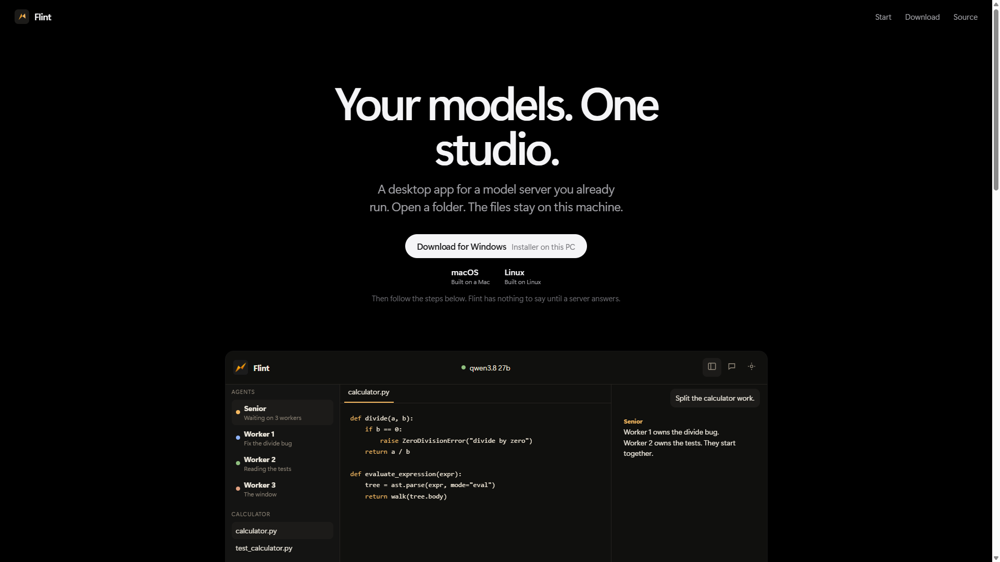
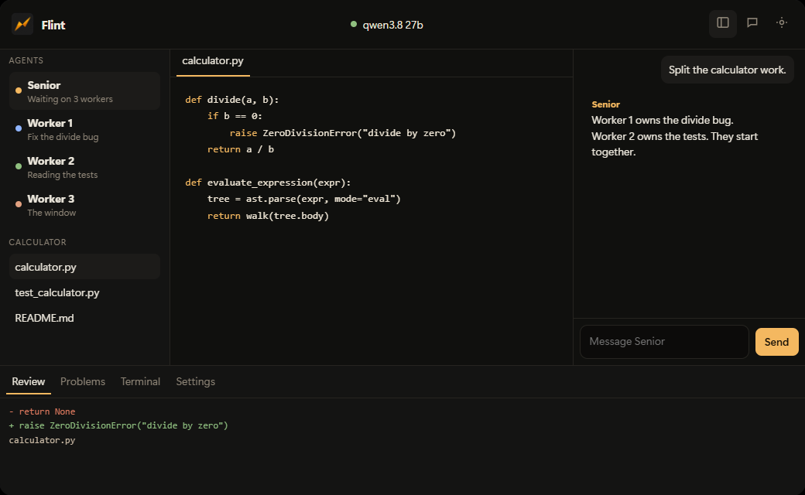
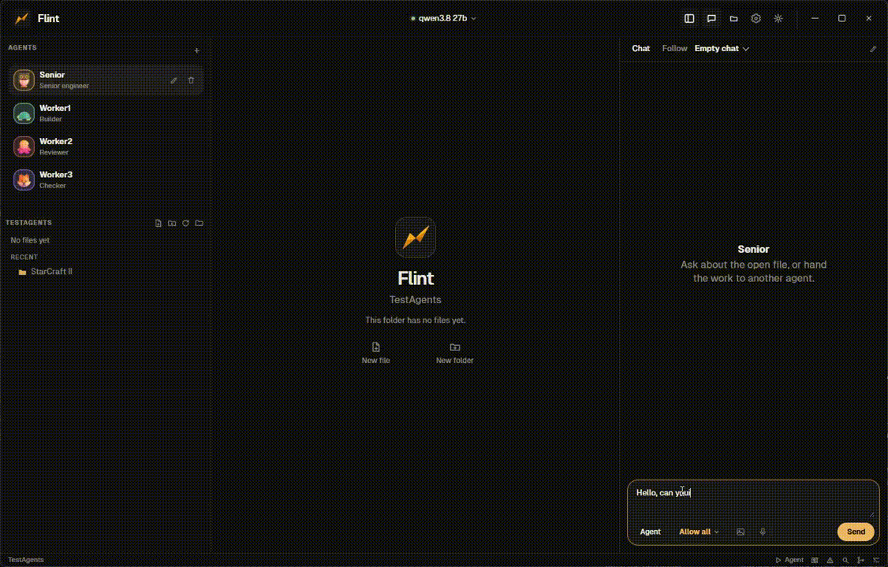
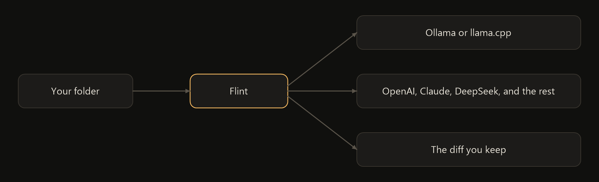
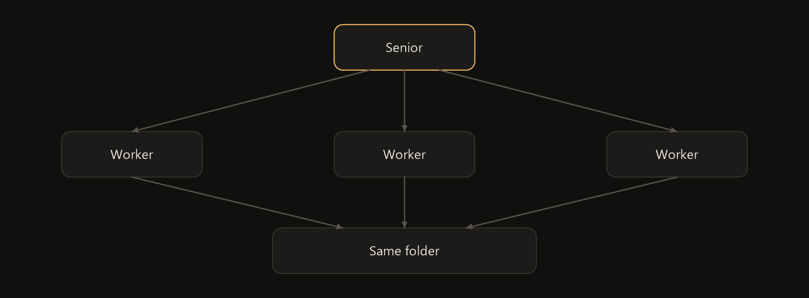

<p align="center">
  
</p>

<h1 align="center">Flint</h1>

<p align="center">
  A desktop app for a local model, or an API you already have.<br>
  Open a folder. Talk to it. Keep the diff.
</p>

<p align="center">
  <a href="https://github.com/kolan51/flint/stargazers"></a>
  <a href="https://github.com/kolan51/flint/releases/latest"></a>
  <a href="https://github.com/kolan51/flint#your-model"></a>
  <a href="LICENSE"></a>
</p>

<p align="center">
  <a href="https://kolan51.github.io/flint/"><strong>See it</strong></a>
  &nbsp;&nbsp;·&nbsp;&nbsp;
  <a href="https://github.com/kolan51/flint/releases/latest">Download</a>
</p>

Point Flint at a model you already run, or an API you already have. Ollama, llama.cpp, LM Studio, OpenAI, Claude, and DeepSeek are in the list. So are Gemini, Grok, Mistral, and the other common ones.

Flint is the window around that model. A chat, an editor, and a small crew of agents. The folder stays where it is.

<p align="center">
  <a href="https://kolan51.github.io/flint/">
    
  </a>
</p>

The [site](https://kolan51.github.io/flint/) has the installers at the top. The window under them is the app: agents on the left, the file in the middle, the chat on the right, and the diff under the editor.

<p align="center">
  
</p>

## How a job moves

One message starts it. The workers take the files.

<p align="center">
  
</p>

<p align="center">
  
</p>

One agent can lead. The others take a piece each, in that same folder, on the model you picked.

<p align="center">
  
</p>

## Your model

Paste the address in Settings and pick it in the title bar.

| You have | Point Flint at |
| --- | --- |
| Ollama | `http://127.0.0.1:11434` |
| llama.cpp or LM Studio | usually `http://127.0.0.1:8080` |
| OpenAI | `https://api.openai.com` |
| Claude | `https://api.anthropic.com` |
| Gemini | `https://generativelanguage.googleapis.com/v1beta/openai` |
| DeepSeek | `https://api.deepseek.com` |
| Grok | `https://api.x.ai` |
| Mistral | `https://api.mistral.ai` |
| Groq | `https://api.groq.com/openai/v1` |
| OpenRouter | `https://openrouter.ai/api` |
| Together, Fireworks, Cerebras, Cohere | the address in Settings, plus the key |

Pick the name in Settings and Flint fills the address. A cloud one also needs its key. Any other OpenAI-compatible address can be pasted in.

A local model and a cloud API can both sit in the list. Switch them from the title bar whenever you want a different one for the chat.

## What you ask

Fix the bug. Add the page. Explain this file. Rename it across the project.

For a bigger job, name one agent to lead and call it whatever you want. It hands each of the others a piece, and they work in the same folder together. Add as many as the job needs. Flint checks how many chats your server can hold at once, and keeps to that.

If it wants to run a command, it shows you first. Run it, allow it, or skip it. There is a Plan mode too, for when you only want it to read.

## Download

Installers for Windows, macOS, and Ubuntu are on the [latest release](https://github.com/kolan51/flint/releases/latest).

| | |
| --- | --- |
| Windows | [Flint Setup](https://github.com/kolan51/flint/releases/latest) |
| Mac | [Disk image](https://github.com/kolan51/flint/releases/latest), Apple silicon and Intel |
| Ubuntu | [`.deb` and AppImage](https://github.com/kolan51/flint/releases/latest) |

Windows may warn before the installer opens. The build is not signed yet.

Or [open the site](https://kolan51.github.io/flint/) and press the button for your machine. Same files.

## From this repo

```bash
npm install
npm run desktop
```

`electron/` is the window. `server/` is the API on this machine. `src/` is the studio. `site/` is the page.

`Ctrl+Shift+O` opens a folder. `Ctrl+K` is the command list. Enter sends.

## Your stuff stays put

Chats, agents, and the project stay on this computer. There is no Flint account to make.

Flint can ask GitHub if a newer version exists. You can turn that off. If an agent searches the web, the query goes to DuckDuckGo, or to Brave when you add a key.

[Privacy](https://kolan51.github.io/flint/privacy.html) · [Terms](https://kolan51.github.io/flint/terms.html)

## FAQ

**Does it need an account?** No. Chats, agents, and the model address stay on this computer.

**Which models?** Ollama and llama.cpp on this machine. OpenAI, Claude, Gemini, DeepSeek, Grok, Mistral, Groq, OpenRouter, Together, Fireworks, Cerebras, and Cohere in the cloud. Several agents can share one. Flint asks the server how many chats it can hold, and stays inside that.

**Where do the edits go?** Into the folder you opened. A change sits in the diff until you keep it. A command does not run until you allow it, unless you have set Allow all.

**Windows warns that the installer is not signed.** That warning is real. There is no signing certificate on these builds yet.

## License

[MIT](LICENSE).
